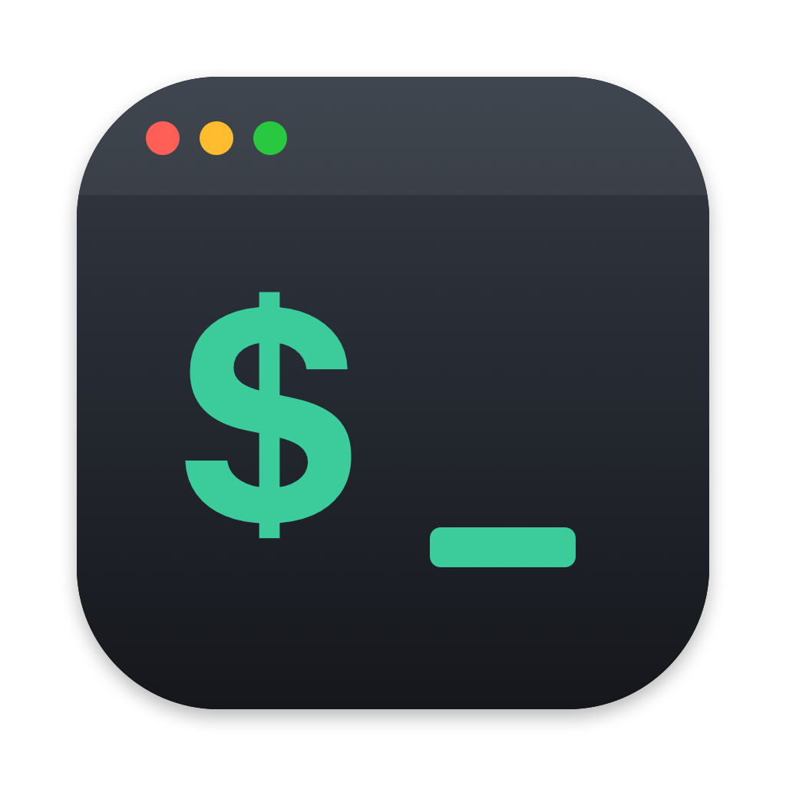
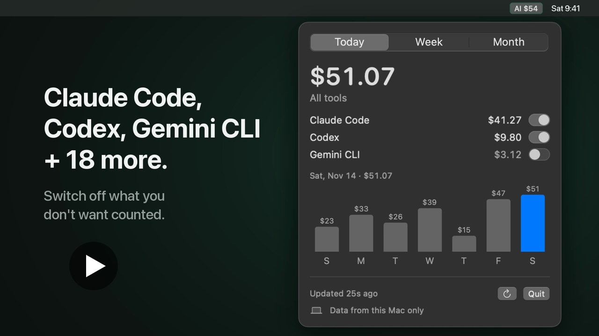

<div align="center">



# AI Spend Bar

See your AI spend in your Mac's menu bar.

[](https://www.npmjs.com/package/ai-spend-bar)  [](LICENSE)

<a href="https://youtu.be/Z_sH5Z3PNxg"></a>

<sub>▶ <a href="https://youtu.be/Z_sH5Z3PNxg">Watch the 20-second demo</a></sub>

</div>

## Install

```sh
npx ai-spend-bar
```

That's it. It starts now and every time you log in. No Node? `curl -fsSL https://raw.githubusercontent.com/crearo/ai-spend-bar/main/install.sh | bash`

Shows today, this week or this month across Claude Code, Codex and the other tools [ccusage](https://github.com/ryoppippi/ccusage) supports. Numbers are the API value of your usage, from local logs on this Mac.

## Uninstall

```sh
npx ai-spend-bar uninstall
```

<sub>MIT · Made by verycuteapps · ☕ <a href="https://buymeacoffee.com/crearo">Buy me a coffee</a></sub>
