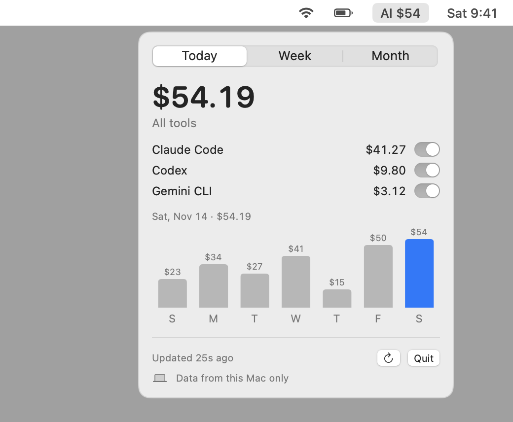

# AI Spend Bar

See how much you've spent on AI coding tools today, right in your Mac's menu bar.

<a href="https://youtu.be/Z_sH5Z3PNxg"></a>

▶ [Watch the 20-second demo](https://youtu.be/Z_sH5Z3PNxg)

<picture>
  <source media="(prefers-color-scheme: dark)" srcset="https://raw.githubusercontent.com/crearo/ai-spend-bar/main/docs/panel-dark.png">
  
</picture>

## Install

```sh
npx ai-spend-bar
```

That's it. It starts now and every time you log in.

No Node? Use `curl -fsSL https://raw.githubusercontent.com/crearo/ai-spend-bar/main/install.sh | bash`

## Uninstall

```sh
npx ai-spend-bar uninstall
```

---

Shows the API value of your usage today, this week or this month across Claude Code, Codex and the other tools [ccusage](https://github.com/ryoppippi/ccusage) supports; toggle tools in the panel. Requires macOS 13+ and Node.js (the installer sets up Node for you).
